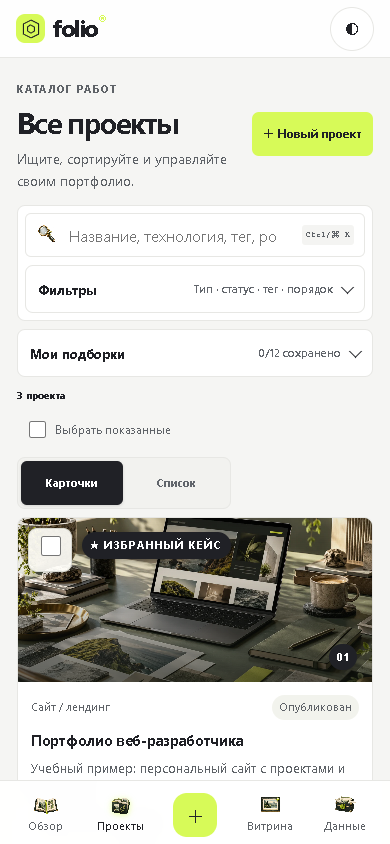
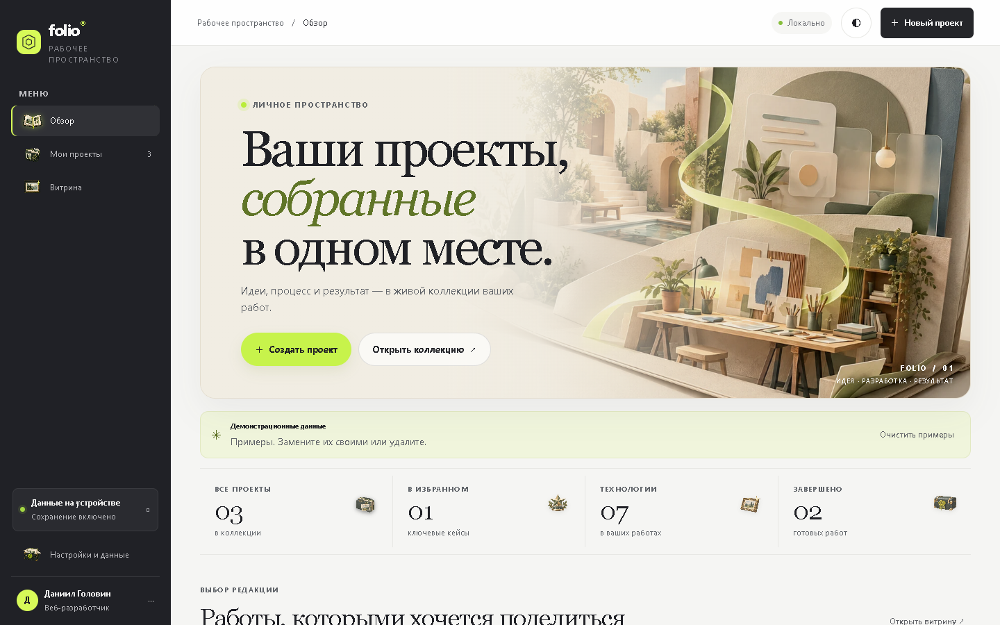

# Изолированная приёмка Web/PWA и Windows v157

Дата: 08.11.2026. Проверена точная onedir-сборка `dist/folio-webview-v157/folio-desktop/folio-desktop.exe` на loopback `127.0.0.1:41768`. Для WebView2 использован отдельный профиль во временной папке; браузерный прогон выполнен в новом изолированном контексте установленного Chrome.

## Что проверено

- 20 состояний: обзор, каталог, витрина и настройки при 320×568, 390×568, 390×844, 768×900 и 1440×900 CSS px.
- На всех состояниях ширина документа совпала с шириной viewport; битых изображений и ошибок страницы/консоли нет.
- Каждая видимая зона управления имеет высоту не менее 44 CSS px. Для нативных checkbox измерялась вся связанная `<label>`-зона, а не маленький графический квадратик.
- На точном v157 пройдено создание синтетического проекта, сохранение после reload, редактирование, Undo удаления и окончательное удаление тестовой записи. После сценария остались три демонстрационные карточки.
- После установки Service Worker браузер переводился offline и выполнял холодную перезагрузку: главная страница, три демонстрационных проекта и изображения остались доступны.
- Все действия выполнялись в свежем изолированном браузерном контексте; пользовательский профиль, рабочая БД и данные из других приложений не использовались.

Подробная матрица, ошибки, значения по каждому состоянию и SHA-256 кадров находятся в [`result.json`](result.json). Полный сценарий повторяется командой:

```powershell
$env:FOLIO_AUDIT_URL = 'http://127.0.0.1:41768/?folio-desktop=1'
python .\run_product_flow_v157.py
```

## Кадры






Длинные кадры всей страницы также оставлены рядом для оценки нижних разделов; viewport-кадры удобнее читать в отчёте и на телефоне.
