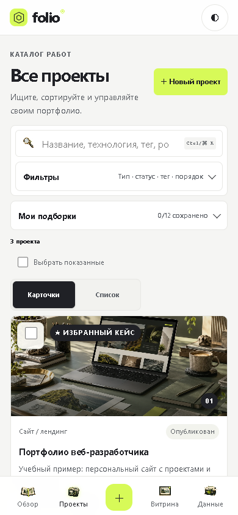

# QA-отчёт Folio — обновлённый кандидат 09.11.2026

## Итог

Проверен локальный кандидат Web/PWA v156, Windows WebView2 v159 и Android debug 0.3.19/code 31. Ресурсы v156 через loopback-host точного v159 прошли в изолированном Chrome 20/20 route/viewport-состояний, CRUD, сохранение после перезагрузки и холодный offline. Нативное окно v159 отдельно проверено на обзоре и витрине. APK v156 установлен поверх прежнего состояния AVD API 36 без очистки данных; уведомление обновления появилось и было применено перезапуском. Отчёты ООП модулей 4–5 расширены, экспортированы и визуально сверены: M4 — 12 страниц, M5 — 17 страниц.

## Состав и проверки

| Часть | Версия | Результат |
|---|---|---|
| Web/PWA | v156 | 78/78 тестов; локальная формулировка хранения согласована между браузером, Windows и Android |
| Windows WebView2 + Web/PWA | v159 + v156 | Точный EXE на loopback; Chrome Playwright: 20/20 route/viewport, CRUD и cold offline; native shell: обзор и витрина; 4 встраиваемых web-файла совпали с исходниками по SHA-256 |
| Android | 0.3.19 / code 31 | v156 ресурсы; обновление поверх 0.3.18 на AVD API 36 без очистки данных; после перезапуска dashboard, 18 именованных и 0 безымянных кликабельных элементов |
| Python, SQLite, desktop host | текущий код | 93/93 при проверке сдачного пакета |
| Отчёты модулей 4–5 | DOCX + PDF | Парные документы синхронны; M4 — 12 страниц, M5 — 17; увеличенные скриншоты проверены визуально |

## Windows и адаптивная веб-версия

Точная сборка `dist/folio-webview-v157/folio-desktop/folio-desktop.exe` запускалась на loopback `127.0.0.1:41768` с новым временным профилем. Browser QA использовал отдельный headless Chromium/Playwright контекст. Персональный Chrome-профиль, рабочая SQLite база и данные других приложений не использовались.

Проверены разделы обзор, каталог, витрина и настройки на 320×568, 390×568, 390×844, 768×900 и 1440×900 CSS px. Итого 20 состояний. Во всех них ширина документа не превышает ширину viewport; битых изображений, ошибок страницы и console errors — 0. Минимальная высота реальной видимой зоны управления — 44 CSS px. Для нативных checkbox учитывалась вся связанная кликабельная `<label>`-область, поэтому размер 13–20 px у графического квадратика не выдавался за размер цели.

В изолированном браузерном контексте пройдены создание синтетической карточки, сохранение после полного reload, редактирование описания, Undo удаления и окончательное удаление после завершения окна Undo. После сценария осталось ровно три демонстрационных проекта. В том же контексте установлен Service Worker; после отключения сети и холодной перезагрузки сохранились обзор, все 3 демо-кейса и обложки. Ошибок браузера не зарегистрировано.

Повторяемый runner, подробный `result.json`, CSS-геометрия, SHA-256 и кадры: [`product-flow-v157/`](04_QA_доказательства/qa_08-11-2026/product-flow-v157/).

### Windows v159 / Web v156: актуальная адаптивная регрессия

Точная сборка `dist/folio-webview-v159/folio-desktop/folio-desktop.exe` запускалась с отдельным Temp-профилем и loopback-портом 41766. В нативном окне проверены обзор и переход в витрину. Сборка обслуживала web-ресурсы v156; в отдельном Chrome Playwright-контексте проверены четыре маршрута на 320×568, 390×568, 390×844, 768×900 и 1440×900 — 20/20 состояний. Горизонтальное переполнение, битые изображения, ошибки страницы/консоли и цели нажатия меньше 44 CSS px — 0.

В том же изолированном браузерном контексте прошли создание синтетического кейса, сохранение после reload, редактирование, Undo удаления, окончательное удаление после 7,4 секунды; после проверки осталось ровно три демо-кейса. Service Worker выдержал offline cold reload: три карточки и изображения загрузились, браузерных ошибок не было. SHA-256 `index.html`, `styles.css`, `app.js`, `sw.js` из собранной v159 совпали с текущими источниками.

Протокол `result.json`, повторяемый runner и 10 скриншотов: [`web-v156-v159-regression/`](04_QA_доказательства/qa_09-11-2026/web-v156-v159-regression/). Нативные снимки 1426 × 820: [`windows-v159-smoke/`](04_QA_доказательства/qa_09-11-2026/windows-v159-smoke/).

## Android AVD

APK `ru.folio.portfolio` версии 0.3.17/code 29 собран из v154 и установлен на выделенный Android API 36 AVD командой `adb install -r`. Удаление приложения, очистка или сброс данных не выполнялись. При первом запуске после обновления старого cache показалось штатное уведомление новой версии; после перезапуска оно исчезло, dashboard и три демонстрационных проекта загрузились.

После полной загрузки UIAutomator увидел 107 узлов, 18 именованных кликабельных элементов и 0 безымянных. APK содержит версию 0.3.17/code29, CSS с высотой кнопки каталога 44 px и Service Worker cache v154. APK SHA-256: `dce9acee471bf8bab3f8a116d03964a2b01520526931e7c72f01e70508b2770d`.

Скриншоты, UIAutomator XML, JSON и повторяемый runner: [`android-v154/`](04_QA_доказательства/qa_08-11-2026/android-v154/).

### Текущий Android v156 / APK 0.3.19

APK `ru.folio.portfolio` версии 0.3.19/versionCode 31 установлен поверх 0.3.18 на выделенный `FolioQA_API36` AVD API 36 (`emulator-5554`) через `adb install -r`; данные не очищались. Первый снимок показывает баннер обновления. После нажатия «Перезапустить» баннер исчез, открылся обзор с тремя демонстрационными проектами. Сохранены исходный и итоговый снимки и два XML-дампа UIAutomator.

Итоговый XML содержит 107 узлов, 18 кликабельных элементов с именем и 0 безымянных кликабельных элементов. SHA-256 APK: `264ecb00d0fc17bc9eaf3c2e56cb45b10760370138b5deaa13218c00c5e7fa52`; ZIP для телефона содержит тот же APK, CRC архива цел. Физический телефон, OEM file picker и речь/жесты TalkBack не проверялись.

Снимки и протокол: [`android-v156/`](04_QA_доказательства/qa_09-11-2026/android-v156/).

## Отчёты модулей 4–5

Финальные пары DOCX/PDF зафиксированы в корне и включаются в сдачный пакет: модуль 4 — 12 страниц, модуль 5 — 17 страниц. Каждая страница имеет извлекаемый текст; аудит сверяет хэши DOCX/PDF, изображения и соответствие текста после экспорта. Скриншоты интерфейса увеличены и разделены по смыслу; в A.4 заменён обрезанный кадр на проверенный полный снимок формы 1282 × 892 px; контактные листы и все 29 полноразмерных рендеров: `04_QA_доказательства/qa_09-11-2026/reports-expanded/m4-contact.png` и `m5-contact.png`.

В M4 включена таблица ответственности `Developer`, `Portfolio`, `Project`, `LandingProject`, `WebAppProject` и `Technology`; после неё проверена целостная UML-схема и алгоритмы добавления, поиска и валидации. Иллюстрации окна «О программе» и формы проекта остаются снимками учебного Tk-интерфейса. Историческая линия отмечает JSON в M4, переход настольной версии на SQLite в M5 и добавление PWA позднее.

В M5 добавлено приложение с трассировкой требований задания к разделам отчёта и текущим QA-доказательствам, уточнены границы проверок и ручного переноса данных. Расширенное приложение A.3–A.5 фиксирует поиск в таблице, валидацию обязательных полей и отменённое удаление; итоговый PDF имеет 17 страниц. Скриншот v157 явно подписан как последующая демонстрация развития продукта, а не исходный экран учебного Tk-приложения. Библиография начинается с номера 1; финальная вёрстка страницы источников проверена.

Подробные рендеры всех страниц (M4 12, M5 17), контактные листы и короткий протокол визуального осмотра: `04_QA_доказательства/qa_09-11-2026/reports-expanded/`.

## Границы проверки и что осталось

Android результат относится к эмулятору, а не к физическому смартфону. Не подтверждены совместимость OEM file picker, речь и жесты TalkBack, Windows Narrator и Magnifier, а также walkthrough с преподавателем/пользователем. Официальный код группы нужно сверить по ведомости; в исходных учебных материалах встречаются разные варианты. APK — debug-сборка, не для Google Play.

Folio хранит данные локально. Браузер, Windows и Android не синхронизируются автоматически; перенос между ними выполняется явным JSON export/import. GitHub Pages остаётся на публичной v120. Кандидат v154/v157/0.3.17 не публиковался.

## Итог текущего прохода

Проверенные DOCX и экспортированные PDF стали каноническими локальными файлами отчётов. Сборщик v133 синхронизировал M4/M5, 29 полноразмерных рендеров страниц, проверенный исходный кадр A.4 и свежие доказательства Windows v159/Android v156. Финальный архив содержит 1062 файлов без manifest; verifier подтвердил хэши, manifest, точный состав ZIP и CRC. Регрессии внутри комплекта: Python 93/93, Web 78/78; аудит отчётов прошёл все проверки, личные SQLite/JSON исключены. SHA-256 записан в sidecar `.zip.sha256` рядом с архивом. Публичный GitHub Pages не обновлялся.
